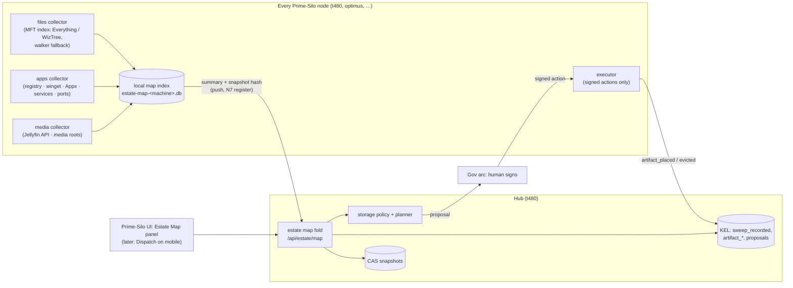

# SOLUTION — The Estate Map: Prime-Silo as the container that knows the whole estate

**Status:** design, authored 2026-09-13 (Claude, frontier authoring) · **Epic:** EP-S · **Milestone:** M10
**Owner directive (2026-09-13):** _"it should be managed from the prime silo UI, we should not be using
tactical end user compute solution of running scripts, prime-silo is the container and should be able to map
the entire estate with applications installed, files, media, everything, once mapped we can then start to
ensure integrity and centralisation and then get to a manageable storage solution and process"_ — and consider
the fast disk mappers (WinDirStat class) for building the map and index.
**Builds on:** EP-N (`SOLUTION-estate.md`: hub/satellite model, N7 register, N5 signed approve-to-sync), EP-L
(L0 KEL, L1 CAS), the artifact ledger (`artifacts.mjs`), the inventory sweep (`inventory.mjs`), heartbeat.

---

## 0. Why this, and why now

The estate today is known in fragments, each correct inside its own boundary and blind outside it:

| Question                                          | Answered by today        | Gap                                              |
| ------------------------------------------------- | ------------------------ | ------------------------------------------------ |
| Is a node/service up?                             | heartbeat (per-node KEL) | —                                                |
| Which sessions differ between hub and satellite?  | EP-N N4 drift            | sessions only                                    |
| Where is this artifact placed, who authorised it? | artifact ledger          | only what someone explicitly `acquire`d/`place`d |
| What is on disk that no ledger explains?          | inventory sweep          | slow Node walk, narrow roots, one machine        |
| What is on the NAS and where did it come from?    | NAS catalog (bb30d0a7)   | one share, driven by scripts                     |
| **What applications are installed, where?**       | nothing                  | **unknown**                                      |
| **What files/media exist across all machines?**   | nothing                  | **unknown**                                      |
| **Which copies are the only copy?**               | nothing                  | **unknown**                                      |

On 2026-09-13 the cost of this showed directly: diagnosing one failed update on the ASUS took a PowerShell
report script, an SMB probe, an OneDrive round-trip and a human relaying results. Every fix that day was a
script a person had to run. That is the tactical EUC pattern the owner is rejecting. The target is the
opposite: **Prime-Silo, which is already installed and self-supervising on every Windows node, observes its
own machine and reports to the hub; the hub folds one map; the UI shows it; changes are proposals a human
signs and a node executes.**

## 1. The shape in one diagram

Direction matters and is inherited from EP-N N7: **nodes push, the hub never reaches in.** Benny and Neo4j bind
loopback only (heartbeat finding 2026-09-05); a satellite behind a Public-profile firewall cannot be probed.
A node that is up says so itself.

## 2. Mapping files fast: use the MFT, not a walk

Speed in WinDirStat-class tools does **not** come from WinDirStat itself — WinDirStat walks directories and is
slow on large volumes. The fast tools read the NTFS **Master File Table** directly:

| Tool                                        | How                                                                          | Live updates        | Licence                            | Role here                                      |
| ------------------------------------------- | ---------------------------------------------------------------------------- | ------------------- | ---------------------------------- | ---------------------------------------------- |
| **Everything** (voidtools)                  | MFT at start, then **USN journal**; a service lets non-admin processes query | **yes, continuous** | freeware, commercial use permitted | **primary adapter** — query via `es.exe` / SDK |
| **WizTree**                                 | MFT read, CSV export from CLI                                                | no (snapshot)       | free for personal use              | snapshot adapter (sizes per folder, fast)      |
| WinDirStat                                  | directory walk                                                               | no                  | GPL                                | not used — the walk is what we are replacing   |
| Node walker (existing `inventory.mjs` walk) | `readdir`/`stat`                                                             | no                  | ours                               | **fallback**: non-NTFS (exFAT, SMB, the Pi)    |

Design consequences:

- **Metadata for everything, hashes only where they pay.** The MFT gives path, size, timestamps for millions of
  files in seconds. Content hashing costs I/O proportional to bytes, so it is tiered:
  1. **Managed roots** (NAS, models, media, downloads, datasets, backups) — every file hashed (sha256), as the NAS
     catalog already does, with size+mtime reuse.
  2. **Everywhere else** — hash only **size collisions** across the estate, first a partial hash (first + last
     4 MB + size), then a full hash when partials match. This is how duplicate finders stay fast.
- **The adapter is an interface, not a dependency.** `collectFiles(volume) → rows` has three implementations;
  the map records which produced each volume's rows, and the benchmark (S1) decides the default from measured
  numbers, not from this document.
- **Installing Everything is a human-signed step** (third-party service reading the MFT on every node).

## 3. What "the map" contains

Per machine, per sweep, one index (SQLite, local to the node) with four tables and a snapshot that goes to the
hub's CAS:

- `volumes` — drive, filesystem, capacity, free, adapter used, sweep time.
- `files` — path, size, mtime, category (derived from path rules + extension), partial/full hash when computed,
  managed-root flag. Excludes OS internals by rule (`Windows\`, `$Recycle.Bin`, pagefile…).
- `apps` — name, version, publisher, install location, source (`registry` HKLM/HKCU/WOW6432, `winget`, `appx`),
  plus services and scheduled tasks and listening ports. Prime-Silo itself appears here, which answers "which
  node runs which Prime-Silo version" without the update-report script.
- `media` — media roots and, where Jellyfin is reachable, its library items (title, path, size).

The hub stores each node's snapshot in CAS and appends one `sweep_recorded` event pointing at its hash
(the `inventory_sweep.mjs` pattern: counts without the observation behind them are not evidence). Placements in
managed roots become `artifact_placed` events — exactly what the NAS catalog already emits — so the existing
lineage, evidence and inventory folds read the map with no new vocabulary.

**Privacy (R31) is structural, not a filter someone must remember.** The map carries paths and hashes, never file
content. Paths matching the job/CV quarantine rules are reduced to a hash and a category before leaving the node.
User profile trees are mapped by size and category; full paths under `C:\Users\<x>` are opt-in per root.

## 4. Integrity, then centralisation, then storage — in that order

The owner's sequence is the right one, because each stage consumes the previous one's output:

1. **Integrity (S5).** From the folded map: duplicates across machines (same full hash), **sole copies** (hash
   with exactly one placement — the files at risk), backup coverage (placements on ≥2 distinct devices), and
   verification sweeps that re-hash managed roots and emit `artifact_verified`. Existing drift (`inventory.mjs`
   orphans/unrecorded) is shown alongside, not reimplemented.
2. **Centralisation (S6).** A declarative `storage-policy.yaml`: category → home (e.g. `models → nas:models`),
   minimum copies, what never leaves its machine (R31), retention. A pure planner diffs the map against the
   policy and **raises proposals** ("move 38 GB of models from optimus to nas:models; 12 files are sole copies").
   Frontier authorship: it asks, it takes nothing.
3. **Storage process (S7).** A signed proposal is executed by the Prime-Silo node that owns the bytes: copy
   (restartable), verify hash at destination, `artifact_placed`, then `artifact_evicted` on the source only after
   verification — the same order `Send-ToNas` uses, moved inside the product. The NAS catalog library
   (`nas_catalog.mjs`) becomes the receiving side's recorder; receipts become unnecessary because the executor
   _is_ the writer.

The tactical scripts written on 2026-09-13 (`estate/*.ps1`) are **bootstrap only**: they exist because remote
access and the share had to be unblocked before the product could take over. S8 retires them — share
provisioning and node remote-access checks move behind an elevation broker the UI invokes, with the human's
consent captured as a signed action rather than a UAC click nobody records.

## 5. The UI (S4)

A Prime-Silo panel `_prime_silo/estate_map` (registered like `release/ext/panels/release.yaml`), reading only
`/api/estate/map*`:

- **Estate** — machines as cards: online (heartbeat), Prime-Silo version, volumes with used/free, last map age.
- **Storage** — treemap by machine → volume → category (the WizTree view, estate-wide), with sole-copy and
  duplicate overlays.
- **Applications** — matrix of apps × machines, version drift highlighted (e.g. Prime-Silo 1.24.4 vs 1.24.5).
- **Media** — library by root and machine, with backup coverage.
- **Plan** — proposals from the planner, each with bytes, file count, sole-copy warnings; sign/decline goes
  through the existing Gov arc. The same API later backs Dispatch on mobile — no second control path.

## 6. Phases → contracts (M10)

| ID  | Contract                                                                                   | Authority    | Deps  |
| --- | ------------------------------------------------------------------------------------------ | ------------ | ----- |
| S0  | map model: node index schema, collector interface, snapshot → CAS + `sweep_recorded`       | agent-ok     | —     |
| S1  | file adapters (Everything, WizTree, walker) + pre-registered benchmark; Everything install | human-signed | S0    |
| S2  | apps/services/ports collector                                                              | agent-ok     | S0    |
| S3  | node push + hub fold + `/api/estate/map` (extends N7 register)                             | human-signed | S0    |
| S4  | Estate Map panel in the Prime-Silo UI                                                      | agent-ok     | S3    |
| S5  | integrity: duplicates, sole copies, coverage, verification sweeps                          | agent-ok     | S1 S3 |
| S6  | storage policy + centralisation planner (proposals only)                                   | agent-ok     | S5    |
| S7  | governed executor: signed move → copy, verify, place, evict                                | human-signed | S6    |
| S8  | retire the tactical scripts: elevation broker for share/remote-access provisioning         | human-signed | S7    |

Human-signed stops are where the estate is changed or exposed: installing a service that reads the MFT on every
node (S1), a new network surface (S3), moving data (S7), and granting the product an elevation path (S8).

## 7. Pre-registered success criteria (recorded before any build)

- **Map speed (S1):** a full metadata map of the T480's C: and F: completes in **under 120 s** with the chosen
  adapter, and the benchmark records the walker's time on the same volumes for comparison. If no adapter beats the
  walker by ≥5× on F:, the adapter layer is not worth its install footprint and S1 says so.
- **Completeness (S1/S2):** file count per volume within **1%** of `fsutil`/MFT ground truth; installed-app count
  equals the union of registry + winget + Appx with duplicates reconciled, and a named sample of 10 known apps
  (Prime-Silo, LM Studio, Tailscale, Node, …) are all present with correct versions on both Windows nodes.
- **No false outages (S3):** a node that stops pushing is shown **stale since T**, never "empty"; a node behind a
  Public firewall still appears because it pushes.
- **Integrity is honest (S5):** "sole copy" is only asserted for hashes computed in full; anything judged from
  size or partial hash is labelled as such, and the counts carry the scope they were measured over.
- **Nothing moves unsigned (S7):** an executor invoked without a signed proposal writes nothing and exits non-zero;
  a move whose destination hash mismatches never evicts the source.

## 8. Out of scope for M10

Linux/HAOS collectors beyond the walker (the Pi is an appliance — `ha store apps` over SSH is a later add);
cloud storage (OneDrive) as a placement target; deduplicating by moving files without a signed proposal;
replacing Jellyfin's own library management.
