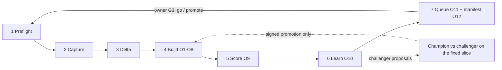

# PLAN — LONGVIEW V8: the queued, self-improving cycle

**Status:** ✅ SIGNED by the owner 2026-11-21 ("Approved", chat; transcribed by Claude — board scope, not a KEL signature) · author: Claude (t480)
**Signed choices (§10):** trigger = weekly or ≥ 25 new sessions, whichever first · manual "go" for the first 2 cycles, then automatic (the standing scheduled trigger is still its own G3 at Y6) · first challenger = SAD V8 · the 10 items in §8 are C1's starting ledger.
**Order (owner):** queued to start after the C0 run completes — see `home_code/DUAL-BRAIN-SYNC.md` §1 queue Q1–Q7.
**Epic:** EP-Y (cYcle) · **Milestone:** M14 (to be written) · **Objective:** O1 + O2
**Builds on (reuse, do not rebuild):** the LONGVIEW pipeline (`scripts/longview/pipeline.mjs`), edition
manifests + `LATEST.json` (`lib/edition.mjs`, 78347cce), session close-out + satellite merge + provenance
(`estate_session_closeout.mjs`, `estate_satellite_merge.mjs`), the EP-L flywheel substrate (KEL L0,
delta cursors L4, execution register L5, single-winner claim L7, daemon + liveness L10, collapse guard
L11, signed promotion + rollback L12/L13, triad dashboard L14), the workflow registry
(`scripts/workflows/registry.mjs`), and the dual-brain §0 process (`home_code/DUAL-BRAIN-SYNC.md`).

> Owner (2026-11-21): "a V8 workflow that will create the list of outputs so we are ready and queued
> with the next job but planned recursive self improvement ensuring nothing is lost for the next cycle
> and increment."

## 1. In one sentence

Every cycle produces the **same named list of outputs**, **scores** them against a frozen rubric,
**writes down what it learned**, and leaves the **next cycle already planned and queued**. Nothing a
cycle made or found is lost: each item is carried forward, done, or dropped by the owner's signature.

## 2. Names (so "latest" is never ambiguous again)

| Word | Means | Changes when | Example |
|---|---|---|---|
| **Workflow V8** | this orchestration (the cycle runner) | a signed plan change | V8 |
| **Cycle C*n*** | one turn of the workflow | every run | C0 = today's baseline run, C1 = first V8 cycle |
| **Edition** | the outputs of one cycle | every cycle | `2026-11-21-t480+optimus` |
| **Method** | the generator of one output | only by a signed promotion | SAD = TOGAF EPIC **V7** (champion), **V8** (challenger) · Book = AI Vampire **V2** · cards = `prompts@<hash>` |
| **Model** | the served LLM | only by L12 promotion | `gemma-4-e4b-agent` |

## 3. The output catalogue — every cycle, same list (`OUTPUTS.json`)

| # | Output | Method / source | Acceptance (gate) |
|---|---|---|---|
| O1 | **Session register** — sessions + episodes by machine × agent | inventory + provenance | 0 unexplained `unknown` hosts; quarantine count only (R31) |
| O2 | **Cards** (delta) | `map`, `prompts@hash` | debt = 0 (`need = inventory − quarantined`), never tuned to pass |
| O3 | **Knowledge graph** + correlation | `graph` + `enrich` | node/edge counts vs C*n−1*, no silent drop |
| O4 | **Code graph** | `code` | phase status honest (no ✓ on a failed phase) |
| O5 | **TOGAF SAD** — champion V7, challenger V8 on the fixed slice | `sad` | rubric score + citation validity |
| O6 | **The AI Vampire** — V2 method | `reduce → opus → pdf` | coverage %, 5/5 eras, 2/2 machines present |
| O7 | Reports: portfolio, themes, timeline, PRD-what-next | `reduce` | each regenerated or explicitly carried |
| O8 | `home_code` indexes + CH-01..08 chapters | `home.mjs build-chapters --verify` | runs only after `runner.lock` is released |
| O9 | **Scorecard** (frozen rubric v*k*) | new (Y2) | scored vs C*n−1* on the same inputs block |
| O10 | **Retrospective + carry-forward ledger** | new (Y3/Y4) | every open item accounted for |
| O11 | **`NEXT.json`** — the queued next cycle | new (Y6) | trigger, expected delta, candidates, preflight list |
| O12 | **Cycle manifest** + `LATEST.json` + KEL `cycle_closed` | extends `edition.mjs` (Y0) | all file hashes; previous cycle's outputs re-verified |
| opt | audiobook · training-data delta (EP-T, privacy-gated) | existing | only when signed for that cycle |

## 4. The cycle

| Stage | What happens | Exists today | New |
|---|---|---|---|
| 1 Preflight | every node `--status` clean; provenance map fresh; endpoints resolve to **localhost** (the stale-IP bug of 11-21); models loaded; no lock; quarantine present; **previous cycle closed + its outputs re-hash** | closeout `--status`, pipeline infra probe | Y1: one preflight, each check with a negative test (no vacuous gates) |
| 2 Capture | close-out sweep on each node; `estate_satellite_merge --host <node>` on the hub | ✓ (11-21) | — |
| 3 Delta | inventory → episodes → one copy per session → real start dates | ✓ (74608284, 78347cce, 502d9f60) | wire L4 delta cursors so the queue is computed, not re-derived |
| 4 Build | pipeline phases, champion methods only | ✓ | honest phase status (fix ✓-hides-failure) |
| 5 Score | frozen rubric v*k*: coverage, era 5/5, machine 2/2, citation validity, freshness, debt, cost (triad L14) | partial (COVERAGE.md, L14) | Y2 scorecard |
| 6 Learn | mine the run record, telemetry, ledger failures and score deltas → findings + candidate improvements (prompt, method, data, code) | — | Y4 retrospective miner |
| 7 Queue | write `NEXT.json` + carry-forward ledger + cycle manifest; L10 daemon starts C*n+1* when the trigger fires (single winner via L7) | L7, L10 | Y6 |

## 5. Nothing lost — the carry-forward contract

1. **Append-only outputs.** An edition folder is never overwritten; superseded cards are moved and journalled (already true). The cycle manifest lists every output with its sha256.
2. **Re-verify the past.** Preflight of C*n+1* re-hashes every output of C*n* (L3 durability). A missing or changed file stops the cycle.
3. **Carry-forward ledger (`CARRY.jsonl`, append-only).** Every finding, gap, debt item and proposal has exactly one state: `open → carried → done(commit/edition)` or `dropped(owner-signed)`. A cycle cannot close while any C*n* item is unaccounted for in C*n+1* (set difference = 0).
4. **Learnings are events.** Retrospective findings go to the KEL (`cycle_learned`), so they are queryable and time-travelable (L8), not buried in chat.
5. **Rollback is always possible.** The previous champion method and model stay servable; promotion is reversible (L12).

## 6. Recursive self-improvement — with brakes

- **Frozen instrument.** The rubric version is fixed before a cycle starts. A rubric change is its own signed change and never ships in the same cycle as a method change (the audit-oracle lesson).
- **Champion / challenger on a fixed slice.** A challenger (e.g. SAD V8, a new card prompt, a new model) runs on the same frozen slice of sessions as the champion; the edition manifests' `inputs` blocks must match, so the comparison is fair.
- **One change class per promotion**, and the measured gain must beat the run-to-run noise measured on the champion itself.
- **Human-signed promotion (G3).** Agents propose; the owner signs. L12/L13 do the mechanics.
- **Collapse guard (L11).** Cap the share of house-model-authored text feeding the next training set; never train on unverified own output.
- **Author ≠ verifier** for every code change, through the board.
- **Privacy every cycle.** The quarantine list is inherited and the privacy phase runs before the graph.

## 7. Increment rules

Cycle numbers only go up. An edition is named `<date>-<machines>`. A method's version bumps only on a
signed promotion (SAD V7 → V8 the day V8 wins on the slice and you sign). A model swap is an L12
promotion. Schemas change additively. `LATEST.json` always names the champion edition; challengers are
listed beside it, never instead of it.

## 8. Carry-forward seeded from C0 (2026-11-21) — the first `CARRY.jsonl`

| # | Item | Owner of the fix |
|---|---|---|
| 1 | 39 sessions with machine `unknown` (38 Claude, 1 Antigravity): older T480 sessions deleted before any backup, or Claude Desktop `audit.jsonl` | Claude (t480) |
| 2 | memo-ray cannot re-home a session (1 grown optimus conversation waits; 62 duplicate Claude entities in the store, merged in LONGVIEW) | memo-ray parsers + a Prime-Silo release |
| 3 | `config/estate-hosts.json` t480 profile points at the old Wi-Fi IP `192.168.68.125` (runs use a localhost override) | Claude (t480) |
| 4 | Pipeline summary shows ✓ on failed phases; `code` needs Benny; `enrich` stalls | Claude (t480) |
| 5 | 20 Antigravity sessions have no dated events (dated by store time, labelled) | Claude (t480) |
| 6 | `estate_satellite_pull.mjs` (Claude-only, old `D:` landing) vs the new merge: retire or fold | owner decision |
| 7 | HC-06: `G-CI-07` checks the wrong lock path (vacuous); `git status` can hydrate OneDrive files; needs a non-author verify | Antigravity (fix) + Claude (verify) |
| 8 | EP-H A3: 69-organ lineage into the graph — waits behind U7/U8 | owner signature |
| 9 | Commits on local `main` not independently verified and not pushed: 74608284, fccdff91, cd5cf535, 78347cce, bef07453, 502d9f60 | verifier + owner (push) |
| 10 | Antigravity has no session-end hook; capture depends on its last-step sweep + the 03:30 task | Antigravity |

## 9. Tasks (EP-Y) — to author on the board after signature

| Task | What | Authority | Deps |
|---|---|---|---|
| Y0 | Cycle manifest + `OUTPUTS.json` catalogue + `LATEST.json` champion/challenger (extends `edition.mjs`) | agent-ok | — |
| Y1 | Preflight: one command, every check with a negative test, re-hash of C*n−1* | agent-ok | Y0 |
| Y2 | Scorecard + frozen rubric v1 (coverage, 5 eras, 2 machines, citation validity, freshness, debt, cost) | **human-signed** (the rubric) | Y0 |
| Y3 | Carry-forward ledger + "nothing lost" close check (set difference = 0) | agent-ok | Y0 |
| Y4 | Retrospective miner: run record + telemetry + ledger + score deltas → findings + candidates | agent-ok | Y2, Y3 |
| Y5 | Champion/challenger runner on a fixed slice (first challenger: SAD V8 = V7 + era- and machine-aware sections) | **human-signed** (promotion) | Y2 |
| Y6 | `NEXT.json` + queue through the L10 daemon: manual "go" until 2 clean cycles, then auto on trigger | **human-signed** (standing) | Y1, Y3 |
| Y7 | Visual cycle tile in Mission/registry: cycle, outputs ✓/✗, score trend, queue, open carry items | agent-ok | Y0, Y2, Y3 |

## 10. Owner decisions needed to sign

1. **Trigger** for the next cycle: weekly, or when new sessions ≥ *N* (proposal: whichever comes first; *N* = 25).
2. **Start mode:** manual "go" for the first 2 cycles, then automatic (proposal: yes).
3. **First challenger:** SAD V8 (proposal), a new card prompt, or a model.
4. Accept the 10 carried items above as C1's starting ledger.
